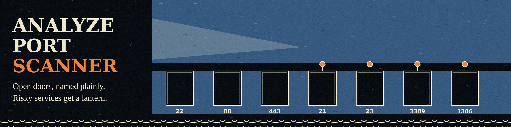

# analyze-port-scanner

This repository currently holds no code. Its contents are this README
and the banner.png and logo.png images.

The description the repo originally carried said it performs a basic
TCP port scan on a given host and displays open ports. No script that
does that is present in the repository, so there is nothing to install
or run here yet. Port scanning tools in this org live in their own
repos when they exist as code.
